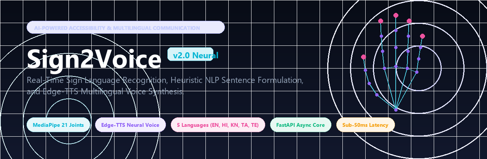
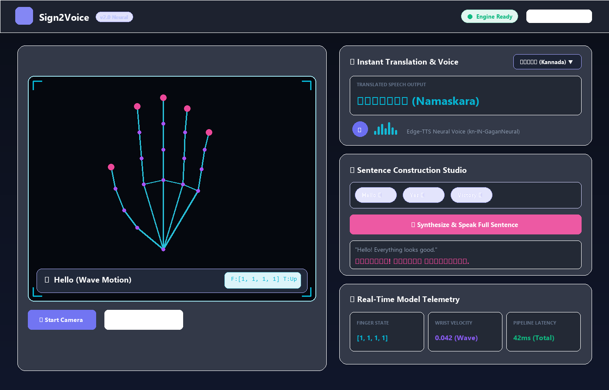
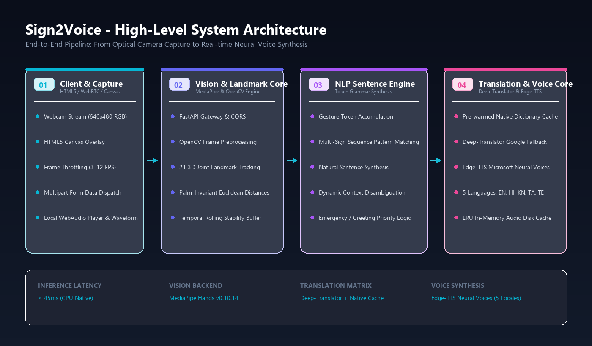
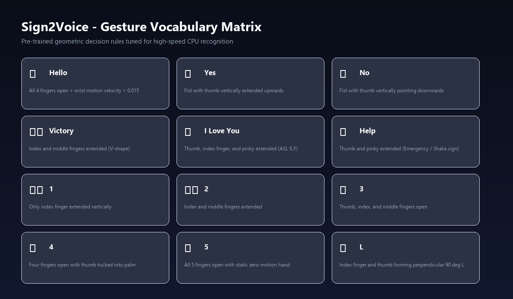

<p align="center">
  
</p>

<p align="center">
  <a href="https://github.com/ritesh0w0/Sign2Voice/blob/main/LICENSE"></a>
  
  
  
  
  
</p>

---

# 🤟 Sign2Voice

> **Real-Time AI Sign Language to Multilingual Voice Synthesis System**  
> Bridging communication barriers by transforming hand gestures and sign language into natural, grammatically structured voice speech across 5 languages in real-time.

**Sign2Voice** is an end-to-end, high-performance computer vision and neural voice synthesis system. Running fully on standard CPU hardware without demanding discrete GPUs, it captures video from any standard webcam, tracks 21 skeletal hand landmarks via MediaPipe, extracts palm-invariant geometric metrics, accumulates gestures into multi-token sequences, and produces human-like neural speech in **English**, **Hindi (हिंदी)**, **Kannada (ಕನ್ನಡ)**, **Tamil (தமிழ்)**, and **Telugu (తెలుగు)**.

---

## 🌟 Key Highlights

- **⚡ Blazing Fast CPU Inference**: Native landmark extraction and geometric classification running at `< 45ms` per frame on standard consumer CPUs.
- **📐 Palm-Scale Invariant Geometry**: Uses Euclidean joint tip-to-knuckle distance ratios that remain reliable regardless of hand tilt, distance, or camera angle.
- **🌊 Temporal Motion & Wave Tracking**: Integrates wrist displacement variance over time to accurately distinguish dynamic gestures (like waving **Hello**) from stationary signs (like number **5**).
- **🧩 Smart NLP Sentence Construction**: Formulates full, conversational sentences from individual sign tokens (e.g. `[Hello, Yes]` $\rightarrow$ *"Hello! Everything looks good."*).
- **🗣️ Edge-TTS Neural Voice Synthesis**: High-fidelity regional neural voices from Microsoft Edge-TTS with low-latency in-memory and disk audio caching.
- **✨ Cyber-Dark Glassmorphic UI**: High-tech responsive dashboard with neon joint canvas rendering, live HUD telemetry, and responsive audio visualizer.
- **🌐 5 Languages Supported**: Seamless translation across English, Hindi, Kannada, Tamil, and Telugu with zero cold-start delay.

---

## 📸 System Screenshots

### 🖥️ Live Glassmorphic Web Dashboard

<p align="center">
  
</p>

The web dashboard features:
1. **Live Vision Stream Viewport**: Real-time camera feed with custom HUD targeting reticle and glowing MediaPipe landmark skeletal overlay.
2. **Instant Translation Card**: Real-time gesture identification with target language selector and dynamic audio playback.
3. **Sentence Construction Studio**: Multi-token accumulation stream where users can chain signs together to form complete sentences.
4. **Telemetry & Model Diagnostics**: Live readouts of finger extension states (`[Index, Middle, Ring, Pinky]`), wrist velocity, and roundtrip processing latency.

---

## 🏗️ System Architecture

Sign2Voice follows a decoupled, modular pipeline designed for low latency, temporal stability, and cross-platform extensibility:

<p align="center">
  
</p>

### 🔄 End-to-End Execution Flow

```mermaid
flowchart LR
    A["📹 Client Webcam<br/>(640x480 RGB @ 5-12 FPS)"] --> B["⚡ FastAPI Gateway<br/>(Multipart Form-Data)"]
    B --> C["🤖 MediaPipe Core<br/>(21 3D Joint Landmarks)"]
    C --> D["📐 Geometric Decision Engine<br/>(Euclidean Ratios & Motion)"]
    D --> E["🛡️ Temporal Stability Buffer<br/>(Majority Rolling Vote)"]
    E --> F["🧩 Sentence Formulation Engine<br/>(NLP Heuristic Sequences)"]
    F --> G["🌐 Multilingual Translation<br/>(Pre-warmed Lexicon / Google API)"]
    G --> H["🔊 Microsoft Edge-TTS<br/>(Neural Audio Synthesis)"]
    H --> I["🎧 WebAudio Dashboard<br/>(Audio Playback & Landmark Overlay)"]
```



---

## 🖐️ Gesture Vocabulary Matrix

Sign2Voice recognizes a rich set of conversational signs, numbers, emergency signals, and American Sign Language (ASL) alphabets:

<p align="center">
  
</p>

| Gesture | Icon | Posture / Geometric Rule | Contextual Meaning |
| :--- | :---: | :--- | :--- |
| **Hello** | 👋 | All 4 fingers open + wrist motion velocity $> 0.015$ | Greeting / Attention |
| **Yes** | 👍 | Closed fist with thumb vertically extended upwards | Affirmation / Approval |
| **No** | 👎 | Closed fist with thumb pointing downwards | Rejection / Disagreement |
| **Victory** | ✌️ | Index and middle fingers extended in V-shape | Victory / Peace / Success |
| **I Love You**| 🤟 | Thumb, index finger, and pinky finger open (ASL ILY) | Affection / Appreciation |
| **Help** | 🤙 | Thumb and pinky open (Emergency / Shaka sign) | Urgent Assistance Needed |
| **1** | ☝️ | Only index finger vertically extended | Numerical One |
| **2** | ✌️ | Index and middle fingers extended | Numerical Two |
| **3** | 🤟 | Thumb, index, and middle fingers extended | Numerical Three |
| **4** | 🖖 | Four fingers open with thumb tucked into palm | Numerical Four |
| **5** | ✋ | All 5 fingers open with static zero-motion hand | Numerical Five / Stop |
| **L** | 🇱 | Thumb and index forming perpendicular $90^\circ$ angle | Alphabet L |
| **Y** | 🇾 | Thumb and pinky open with index/middle/ring folded | Alphabet Y |

---

## 🧩 Intelligent Sentence Construction

Individual signs are accumulated into token streams to generate coherent, fluent conversational dialogue:

| Input Sign Tokens | NLP Synthesized Formulation | Kannada Translation (ಕನ್ನಡ) | Hindi Translation (हिंदी) |
| :--- | :--- | :--- | :--- |
| `["Hello"]` | *"Hello! How can I assist you?"* | ನಮಸ್ಕಾರ, ನಾನು ನಿಮಗೆ ಹೇಗೆ ಸಹಾಯ ಮಾಡಬಹುದು? | नमस्ते, मैं आपकी क्या मदद कर सकता हूँ? |
| `["Hello", "Yes"]` | *"Hello! Everything looks good."* | ನಮಸ್ಕಾರ! ಎಲ್ಲವೂ ಸರಿಯಾಗಿದೆ. | नमस्ते! सब कुछ ठीक है. |
| `["Hello", "I Love You"]` | *"Hello! It is wonderful to see you."* | ನಮಸ್ಕಾರ! ನಿಮ್ಮನ್ನು ನೋಡಿ ತುಂಬಾ ಸಂತೋಷವಾಯಿತು. | नमस्ते! आपसे मिलकर बहुत खुशी हुई. |
| `["Hello", "Victory"]` | *"Greetings! We have achieved success."* | ನಮಸ್ಕಾರ! ನಾವು ಯಶಸ್ಸನ್ನು ಸಾಧಿಸಿದ್ದೇವೆ. | नमस्ते! हमने सफलता प्राप्त की है. |
| `["No", "Help"]` | *"I am facing an issue, please help me immediately."* | ನನಗೆ ತಕ್ಷಣ ಸಹಾಯ ಬೇಕಾಗಿದೆ, ದಯವಿಟ್ಟು ಸಹಾಯ ಮಾಡಿ. | मुझे तुरंत मदद की ज़रूरत है, कृपया सहायता करें. |
| `["Victory", "Yes"]` | *"Yes! We are victorious."* | ಹೌದು! ನಾವು ವಿಜಯಶಾಲಿಗಳು. | हाँ! हम विजयी हैं. |

---

## 🛠️ Technology Stack

| Layer | Component | Version / Tech | Description |
| :--- | :--- | :--- | :--- |
| **Backend Framework** | FastAPI | `0.100+` | High-performance asynchronous REST API server |
| **ASGI Server** | Uvicorn | `0.23+` | Blazing-fast ASGI production web server |
| **Computer Vision** | Google MediaPipe | `0.10.14` | 21-point 3D hand landmark detection pipeline |
| **Image Processing** | OpenCV | `4.8+` | Image buffer decoding, RGB conversion, and matrix ops |
| **Audio Synthesis** | Microsoft Edge-TTS | `6.1.9+` | Ultra-natural neural text-to-speech engine |
| **Translation** | Deep-Translator | `1.11.4+` | Google Translate fallback with pre-warmed dictionary cache |
| **Frontend UI** | HTML5 / CSS3 / Vanilla JS | Modern ES6+ | Glassmorphism dark-theme with canvas skeletal overlay |

---

## 🚀 Quick Start Guide

### Option 1: One-Click Launchers

#### On Windows:
Double-click **`run.bat`** in the repository root. It verifies Python, installs dependencies, and launches the server.

#### On Linux / macOS:
```bash
chmod +x run.sh
./run.sh
```

---

### Option 2: Manual Setup

#### 1. Clone the Repository
```bash
git clone https://github.com/ritesh0w0/Sign2Voice.git
cd Sign2Voice
```

#### 2. Create and Activate a Virtual Environment
```bash
# Windows
python -m venv venv
venv\Scripts\activate

# Linux / macOS
python3 -m venv venv
source venv/bin/activate
```

#### 3. Install Dependencies
```bash
pip install -r requirements.txt
```

#### 4. Run the Application Server
```bash
python main.py
```

#### 5. Open Web Dashboard
Navigate to **`http://localhost:8000`** in your browser (Chrome or Edge recommended for optimal WebRTC camera performance).  
Interactive API Docs are available at **`http://localhost:8000/docs`**.

---

## 🧪 Testing

To run the automated API and vision pipeline test suite:

```bash
python tests/test_api.py
```

The test validates:
- System health and engine status (`/api/health`)
- Supported languages and signs registry (`/api/supported`)
- Multi-token sentence formulation and multilingual translation (`/process_sentence`)
- Frame processing and temporal majority voting filter (`/process_frame`)

---

## 📂 Project Directory Structure

```plaintext
Sign2Voice/
├── assets/
│   ├── banner.png                  # High-res GitHub project banner
│   ├── architecture_diagram.png    # Detailed technical architecture diagram
│   ├── dashboard_screenshot.png    # High-fidelity UI dashboard screenshot
│   └── gesture_matrix.png          # Visual gesture reference matrix
├── docs/
│   └── API.md                      # Comprehensive REST API specifications
├── scripts/
│   └── generate_assets.py          # Programmatic visual asset generation script
├── static/
│   ├── audio/
│   │   └── .gitkeep                # Audio storage directory (MP3 files gitignored)
│   ├── css/
│   │   └── style.css               # Glassmorphic dark theme stylesheet
│   ├── js/
│   │   └── app.js                  # Webcam controller, canvas landmarks, TTS audio
│   └── index.html                  # Main Web Dashboard UI
├── tests/
│   └── test_api.py                 # Automated pipeline and endpoint test suite
├── .gitignore                      # Git ignore rules for virtualenvs, caches, audio
├── LICENSE                         # MIT License
├── README.md                       # Master project documentation
├── main.py                         # FastAPI application entrypoint
├── requirements.txt                # Pinned production dependencies
├── run.bat                         # One-click Windows launcher
├── run.sh                          # One-click Unix / macOS launcher
├── sentence_engine.py              # NLP sentence formulation logic
├── sign_recognition.py             # MediaPipe 21-landmark gesture recognition core
├── translation_service.py          # Multilingual dictionary & Google Translate fallback
└── tts_service.py                  # Edge-TTS voice synthesis engine with caching
```

---

## 🗺️ Roadmap & Future Enhancements

- [x] Real-time 21-point hand tracking with MediaPipe
- [x] Euclidean distance knuckle-to-wrist geometric decision algorithms
- [x] Temporal stability smoothing buffer (3-frame rolling majority)
- [x] Edge-TTS neural speech across 5 regional Indian languages
- [x] Full sentence synthesis from token sequences
- [ ] Two-handed ASL / ISL gesture recognition support
- [ ] Dynamic LSTM / Transformer gesture sequence model for complex sign sentences
- [ ] Mobile PWA deployment with offline client-side ONNX runtime
- [ ] WebSocket streaming endpoint for ultra-low latency sub-20ms frame transfer

---

## 🤝 Contributing

Contributions, issues, and feature requests are welcome!

1. Fork the repository
2. Create your feature branch (`git checkout -b feature/AmazingFeature`)
3. Commit your changes (`git commit -m 'Add some AmazingFeature'`)
4. Push to the branch (`git push origin feature/AmazingFeature`)
5. Open a Pull Request

---

## 📜 License

Distributed under the **MIT License**. See [`LICENSE`](LICENSE) for full details.

---

<p align="center">
  Crafted with ❤️ for accessible, barrier-free communication worldwide.
</p>
